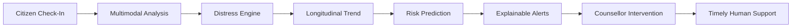

# MANOSETHU

> **Understanding distress before it becomes a crisis.**  
> Continuous Emotional Wellbeing & Distress Monitoring Platform

[](https://www.typescriptlang.org/)
[](https://react.dev/)
[](https://tanstack.com/router)
[](https://tailwindcss.com/)
[](#privacy--statutory-compliance)

---

## Overview

**ManoSethu** is an intelligent, privacy-conscious digital mental-wellbeing and safety platform designed to provide continuous emotional support across long-term recovery and procedural journeys.

Rather than relying on isolated milestone interactions or waiting for crisis escalation, ManoSethu establishes an empathetic digital bridge—combining low-barrier citizen check-ins, multimodal speech and text signal extraction, deterministic distress scoring, and proactive explainable alerting for certified counsellors and caseworkers.

---

## Core Capabilities



### 1. Multimodal Signal Understanding
- **Subjective Affect & Safety**: 5-point validated affect scale combined with environmental safety perception tracking.
- **Linguistic Text Analysis**: Domain-adapted NLP extracting fear, procedural stress, isolation, and coping indicators without exposing raw model reasoning.
- **Voice Prosody & Acoustic Pacing**: In-browser audio capture analyzing vocal hesitancy, speech tremor, and conversational response latency.

### 2. Deterministic Dynamic Distress Scoring
- Transparent, bounded $(0-100)$ scoring system mapped to 4 operational bands:
  - **STABLE** $(0-30)$
  - **ELEVATED** $(31-50)$
  - **HIGH** $(51-70)$
  - **CRITICAL** $(71-100)$
- Weighted vector synthesis: Affect ($25\%$), Safety ($25\%$), Symptom Inventory ($30\%$), Multimodal Text/Voice Indicators ($20\%$).

### 3. Predictive Escalation & Risk Velocity
- Trajectory velocity modeling evaluating $7\text{–}14$ day escalation likelihood based on multi-week slope shifts and upcoming procedural milestone proximity.

### 4. Human-in-the-Loop Caseworker Console
- **Explainable Alert Queue**: Clear signal attribution and contextual triggers.
- **Intervention Desk**: Direct logging of 6 concrete caseworker support actions (*Contact Person*, *Request Counselling*, *Offer Support*, *Schedule Follow-up*, *Mark Resolved*).
- **2-Way Supportive Messaging**: Secure communication channel between citizens and assigned caseworkers.

### 5. Platform Governance & Admin Console
- **User Management**: Role-based access control (`USER`, `COUNSELLOR`, `ADMIN`) with real-time status toggling.
- **Model Registry**: Transparent versioning, status monitors, and confidence scoring across all analytical engines.
- **Immutable Audit Trail**: Chronological event logging across every check-in, alert resolution, and data export.
- **Dynamic Threshold Calibration**: Real-time sensitivity sliders for system-wide alert dispatch.

---

## Privacy & Statutory Compliance

ManoSethu is engineered on **privacy-by-design** principles aligned with the **Digital Personal Data Protection (DPDP) Act**:
- **Pseudonymized Case Codes**: Identifiers decouple citizen personal identities from sensitive well-being check-ins (e.g. `AN-8921`).
- **Strict Data Minimization**: No background surveillance, location tracking, or passive microphone eavesdropping.
- **Audited Access**: Every counsellor review and intervention action is permanently recorded in the audit log.
- **Data Portability**: Citizens can download their complete check-in archive as verified, structured JSON anytime.

---

## Tech Stack

| Layer | Technology |
|---|---|
| **Framework** | React 19 & TanStack Start / Router |
| **State & Query** | TanStack React Query & React Context Store |
| **Styling** | Tailwind CSS v4 & Lucide Icons |
| **Motion** | GSAP 3 & ScrollTrigger |
| **Build Tool** | Vite 7 (Client & SSR) |
| **Language** | TypeScript 5.7 |

---

## Getting Started

### Prerequisites
- Node.js `20.18+` or `22+`
- npm `10+`

### Installation

1. Clone the repository:
   ```bash
   git clone https://github.com/suryarajamandapalli/Manosethu.git
   cd Manosethu
   ```

2. Install dependencies:
   ```bash
   npm install
   ```

3. Start the local development server:
   ```bash
   npm run dev
   ```

4. Open your browser and navigate to:
   ```
   http://localhost:3000
   ```

### Production Build
To create an optimized production build:
```bash
npm run build
```

---

## License

Private and Confidential · All Rights Reserved · MANOSETHU
